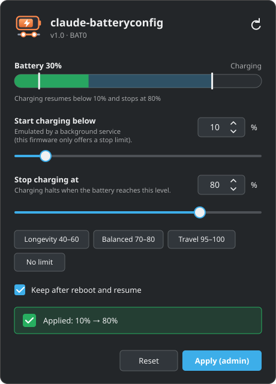

# claude-batteryconfig v1.0

KDE Plasma 6 panel widget for **CachyOS on the Lenovo Legion Go S** that sets when
the battery **starts charging** and when it **stops charging**.

- Sliders and editable number boxes for both thresholds
- Live battery bar showing the charge window
- Presets shown as "resume below → stop at": Lifespan 30→80, Daily 20→90, Full 20→100, No limit
- Optional "keep after reboot and resume"
- Admin rights are requested only when you press **Apply** (polkit prompt)

<p align="center">
  
</p>

## Requirements

- KDE Plasma 6 (default on CachyOS KDE), `kpackagetool6`, `polkit`, `systemd`
- A kernel that exposes battery charge control in sysfs (see "Legion Go S support")

## Install

```bash
chmod +x install.sh uninstall.sh
./install.sh
systemctl --user restart plasma-plasmashell
```

Then right-click the panel, choose **Add Widgets**, and add **claude-batteryconfig**.

Optional: `./install.sh --passwordless` lets members of the `wheel` group apply
without a password prompt (installs a polkit rule).

Uninstall with `./uninstall.sh`.

## Usage

1. Click the panel icon.
2. Set **Start charging below** and **Stop charging at** with the sliders or by typing a value.
   Start is always lower than stop; the stop limit has a 20% floor.
3. Optionally tick **Keep after reboot and resume**.
4. Press **Apply (admin)** and authenticate.

Hover the icon for a summary of the current limits and battery state.

## Legion Go S support (CachyOS)

The Go S firmware has no percentage register. Its only charge control is a Lenovo
WMI switch (feature `0x03010001`): **Standard** (charge to 100%) or **Long Life**
(firmware holds charge at 80%). The helper turns that switch into configurable
limits and picks a backend automatically:

| Backend | When | How it works |
|---|---|---|
| native | kernel has `charge_control_start_threshold` and `charge_control_end_threshold` | values written directly |
| end | kernel has only `charge_control_end_threshold` | stop limit written directly; START emulated by the service |
| type | Go S firmware switch, via the kernel's `charge_type(s)` file, or via `acpi_call` (`\_SB.GZFD.WMAE`) when the kernel has no interface | `claude-batteryconfig.service` (checks every 15 s) flips Standard / Long Life to enforce your levels |

On the Go S this means:
- **Stop limit: 80-100%.** 80 is pure firmware; 81-99 is enforced by the service.
- **Start threshold:** works above 80%. Below 80% the firmware cannot hold charge,
  so a lower start behaves as 80%.
- Settings that need the service are always saved (the checkbox is locked on).
  "Firmware cap 80" and "No limit" need no service.
- If the service stops, the widget warns that the start threshold is not enforced.

### acpi_call on CachyOS

If your kernel has no charge interface, the helper uses the `acpi_call` module (the
same method Handheld Daemon uses). `install.sh` offers to install it:

```bash
sudo pacman -S --needed acpi_call-dkms   # plus headers for your kernel, e.g. linux-cachyos-headers
sudo modprobe acpi_call
```

It is loaded at boot through `/etc/modules-load.d/claude-batteryconfig.conf`.

Do not run this together with Handheld Daemon's charge-limit setting: they will fight.

**Not verified on real Legion Go S hardware.** The ACPI call format comes from
Handheld Daemon's source; if the firmware rejects a value the helper reports an error
and leaves the previous setting.

## Troubleshooting

```bash
claude-batteryconfig-helper diag      # kernel, product, power_supply, lenovo modules
claude-batteryconfig-helper status    # what the widget reads
ls /sys/class/power_supply/*/charge_control_*
systemctl status claude-batteryconfig.service
```

Include the `diag` output when reporting a problem.

## What gets installed

| Path | Purpose |
|---|---|
| `~/.local/share/plasma/plasmoids/org.claudemods.batteryconfig/` | the widget |
| `~/.local/share/icons/hicolor/scalable/apps/claude-batteryconfig.svg` | icon |
| `/usr/local/bin/claude-batteryconfig-helper` | root helper (`status`, `set`, `daemon`, `diag`) |
| `/usr/share/polkit-1/actions/org.claudemods.batteryconfig.policy` | polkit action for the helper |
| `/etc/systemd/system/claude-batteryconfig.service` | restores limits at boot and after resume; runs the emulation loop |
| `/etc/claude-batteryconfig.conf` | saved `START` / `END` |
| `/etc/polkit-1/rules.d/49-claude-batteryconfig.rules` | only with `--passwordless` |

## Security

Only the helper runs as root. It accepts just `set START END [persist|nopersist]`,
validates `0 <= START < END <= 100`, parses the config file instead of sourcing it,
and writes only to the battery's `charge_control_*` files.

## Project layout

```
plasmoid/      widget (metadata.json, contents/ui, contents/icons)
helper/        root helper, polkit policy, systemd unit
install.sh  uninstall.sh
```

## License

claude-batteryconfig is free software, licensed under the
[GNU General Public License v3.0 or later](LICENSE) (`GPL-3.0-or-later`).
It comes with ABSOLUTELY NO WARRANTY. It writes to battery firmware controls, so use it at your own risk.
